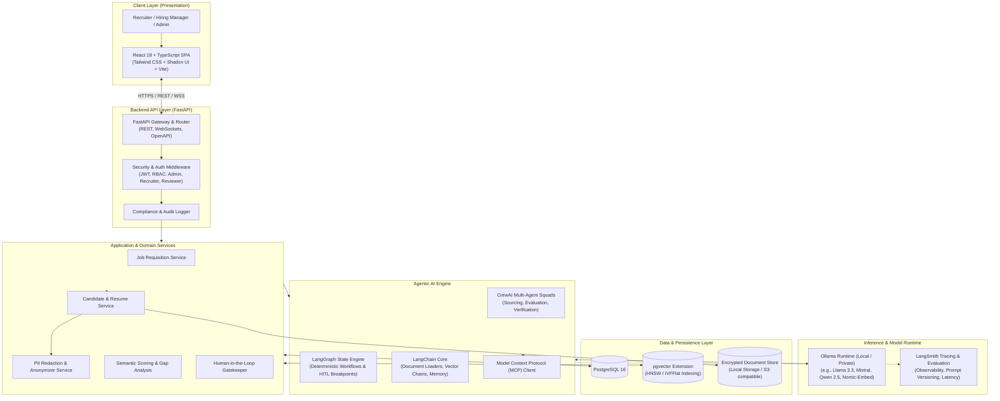
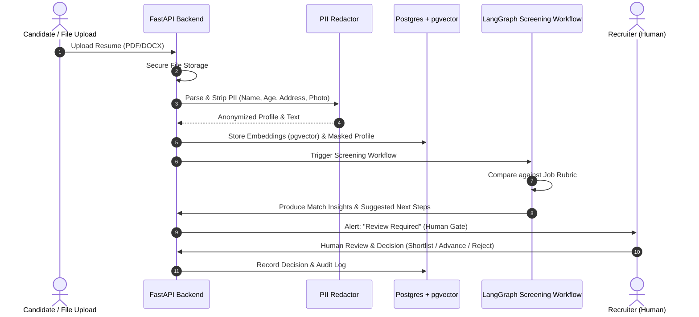

# DCI HireMind – Enterprise AI HR & Recruitment Automation Platform
## System Architecture Specification

---

## 1. Executive Summary & Vision

**DCI HireMind** is an enterprise-grade AI-powered recruitment intelligence and workflow automation platform. It is engineered to assist HR professionals, talent acquisition teams, and hiring managers across the full talent acquisition lifecycle—from intelligent job requisition formulation and ethical candidate matching to multi-agent resume synthesis, interview intelligence, and structured decision support.

### Core Architectural Tenets
1. **Human-in-the-Loop (HITL) by Design**: The AI system acts purely as an assistive intelligence and recommendation layer. **No candidate is ever automatically rejected.** Final decisions (shortlisting, interview advancement, rejection, offers) require explicit human approval.
2. **Algorithmic Fairness & Bias Mitigation**: Sensitive personal identifiers (age, gender, ethnicity, physical appearance, marital status, religion, exact graduation years, and zip codes) are scrubbed before ranking and semantic matching (blind screening protocol).
3. **Auditability & Explainability**: Every score, recommendation, and summary is linked to source evidence from candidate resumes and job criteria, traceable via LangSmith and persistent audit logs.
4. **Modularity & Loose Coupling**: Independent frontend, backend, agent orchestration, and database services communicating over strict typed interfaces (OpenAPI, MCP, async queues).
5. **Data Sovereignty & Privacy**: On-premise/private cloud-ready LLM inference via **Ollama**, ensuring candidate resumes and corporate job descriptions never leak to public endpoints.

---

## 2. High-Level System Architecture

---

## 3. Technology Stack & Component Responsibilities

| Layer | Technology | Version / Spec | Primary Responsibility |
| :--- | :--- | :--- | :--- |
| **Frontend** | React, TypeScript, Vite, Tailwind CSS, TanStack Query | React 18+, TS 5.x | Responsive recruiter dashboard, blind review UI, workflow approval gates, candidate comparative matrices. |
| **Backend API** | FastAPI, Pydantic v2, Python | Python 3.12, FastAPI 0.115+ | High-throughput asynchronous REST & WebSocket API, validation, business logic, authorization. |
| **Database** | PostgreSQL + pgvector | PostgreSQL 16+ | Relational data persistence (users, jobs, candidates, audit logs) and dense vector similarity search. |
| **ORM / Migration** | SQLAlchemy 2.0 (async), Alembic | SQLAlchemy 2.0.x | Async database access, connection pooling, and schema migration tracking. |
| **Agentic Workflows** | LangGraph | Latest Stable | Cyclic, stateful graph workflows with built-in checkpointing and Human-in-the-Loop approval interrupts. |
| **Multi-Agent Teams**| CrewAI | Latest Stable | Specialized autonomous agent squads (e.g., Job Profiler, Skills Extractor, Interview Question Designer). |
| **LLM & Embeddings** | Ollama | Latest Stable | Local, private execution of open-source LLMs (e.g., Llama 3.1/3.3, Mistral) and embedding models (e.g., `bge-m3`, `nomic-embed-text`). |
| **Tool Protocol** | Model Context Protocol (MCP) | Spec 2024-11 | Standardized connectors to external enterprise tools (ATS, HRIS, calendar, background check simulators). |
| **Observability** | LangSmith & OpenTelemetry | Current | Tracing agent chains, token usage, latency monitoring, hallucination detection, prompt evaluation. |
| **Containerization** | Docker, Docker Compose | Engine 26+, Compose v2 | Local and staging orchestration for repeatable, isolated multi-service environments. |

---

## 4. Ethical AI & Human-in-the-Loop (HITL) Guardrails

### 4.1 Strict No Auto-Rejection Policy
- The AI engine generates:
  - **Match Analysis**: Skill overlaps, identified gaps, experience alignment.
  - **Explainable Highlights**: Why a candidate was flagged as a strong or moderate match, with direct resume quotes.
  - **Interview Recommendations**: Tailored technical and behavioral questions.
- Under **no circumstance** does the system transition a candidate to a `REJECTED` state automatically. All candidate state transitions require a logged recruiter confirmation.

### 4.2 Blind Resume Screening Pipeline
To prevent implicit or algorithmic bias, candidate profiles pass through a strict sanitization stage:
1. **Raw Document Intake**: Original resume stored in encrypted document storage.
2. **Anonymizer Engine**: Removes or masks:
   - Full Name, Gender pronouns, Photographs.
   - Contact details (phone number, residential address, personal email).
   - Non-essential dates that signal age (e.g., high school graduation year).
   - Nationality, ethnicity indicators, marital status.
3. **Anonymized Profile Generation**: Semantic matching and LLM evaluation occur exclusively on skills, project accomplishments, certifications, and contextual experience.
4. **De-anonymization Permission**: Full recruiter access to identity is unlocked only when scheduling interviews.

---

## 5. Architectural Modules Breakdown

### 5.1 Frontend Architecture (`frontend/`)
- **Single Page Application (SPA)** built with Vite + React + TypeScript.
- **State Management**: TanStack Query (React Query) for server state caching; Zustand for lightweight local state.
- **Key Modules**:
  - `JobRequisitions`: Create, manage, and AI-refine job specifications.
  - `CandidatePool`: Search, filter, and view candidates in standard and blind modes.
  - `ComparisonView`: Side-by-side candidate comparison based on objective criteria.
  - `ApprovalInbox`: Dedicated queue for Human-in-the-Loop actions (approvals/rejections/escalations).
  - `AuditLogViewer`: Compliance dashboard tracking all AI evaluations and human overrides.

### 5.2 Backend Architecture (`backend/`)
Following a clean, layered architecture:
- **`app/api/`**: Router layer defining REST endpoints and request/response models.
- **`app/core/`**: Configuration (`pydantic-settings`), security (OAuth2/JWT, password hashing), database engine session managers.
- **`app/models/`**: SQLAlchemy declarative ORM models.
- **`app/schemas/`**: Pydantic v2 schemas for request validation and serialization.
- **`app/services/`**: Pure business logic (e.g., parsing, scoring calculations, audit logging).
- **`app/agents/`**:
  - `crews/`: CrewAI multi-agent definitions (agents, tasks, custom tools).
  - `workflows/`: LangGraph state graphs with persistent checkpoints.
  - `prompts/`: Version-controlled prompts designed for deterministic output.
- **`app/mcp/`**: Model Context Protocol clients and servers for external integrations.

### 5.3 Agentic Orchestration Strategy
- **LangChain**: Baseline framework for document parsing (PyPDF, Docx), text chunking, and embedding generation via Ollama.
- **LangGraph**: Orchestrates state machines where transitions require checkpoints and human approvals (e.g., `ScreeningState` $\rightarrow$ `HumanApprovalInterrupt` $\rightarrow$ `InterviewSchedulingState`).
- **CrewAI**: Used where collaborative reasoning between multiple roles produces higher quality outputs (e.g., a "Job Description Formulator" crew consisting of a Market Research Agent, a Technical Role Specialist, and a DEI Compliance Agent).
- **LangSmith**: Integrated as the telemetry backbone to monitor token consumption, trace agent tool calls, benchmark prompt variations, and log evaluation datasets.

---

## 6. Data Architecture & Persistence

### 6.1 PostgreSQL + pgvector Schema Overview
- **`users`**: System users (recruiters, hiring managers, administrators) with Role-Based Access Control (RBAC).
- **`jobs`**: Requisitions with detailed requirements, required skills, experience ranges, and dense vector embeddings of requirements.
- **`candidates`**: Master candidate entity with contact details (restricted access).
- **`resumes`**: Raw document metadata, parsed structured sections, anonymized representations, and resume-level vector embeddings.
- **`candidate_evaluations`**: AI-generated assessment reports, match scores, gap rationales, and recommended questions.
- **`human_decisions`**: Immutable log of every recruiter action (approvals, stage transitions, notes, rejection reasons).
- **`audit_logs`**: System-level compliance logging (who viewed what, when PII was accessed, model parameters used for scoring).

### 6.2 Vector Search Mechanics
- Embedding Model: Locally served via Ollama (e.g., `bge-m3` or `nomic-embed-text`, 768 or 1024 dimensions).
- Distance Metric: Cosine Distance (`vector_cosine_ops`).
- Indexing: HNSW (Hierarchical Navigable Small World) index in PostgreSQL for fast, scalable nearest-neighbor queries.

---

## 7. Security, Privacy & Compliance

1. **Role-Based Access Control (RBAC)**:
   - `ADMIN`: Full system configuration, model management, audit log access.
   - `RECRUITER`: Job creation, candidate evaluation, interview scheduling, full profile access upon stage unlock.
   - `REVIEWER / INTERVIEWER`: Blind profile evaluation, notes submission, question rubric access.
2. **Data Encryption**:
   - In Transit: TLS 1.3 enforced for all external and internal API communication.
   - At Rest: AES-256 encryption for stored resume files and sensitive database fields.
3. **Data Protection Compliance (GDPR / CCPA / EEOC)**:
   - Candidate Right to Explanation: All AI evaluations are stored with their textual reasoning.
   - Data Deletion & Retention: Automated retention timers and hard deletion cascades for candidate records upon request.

