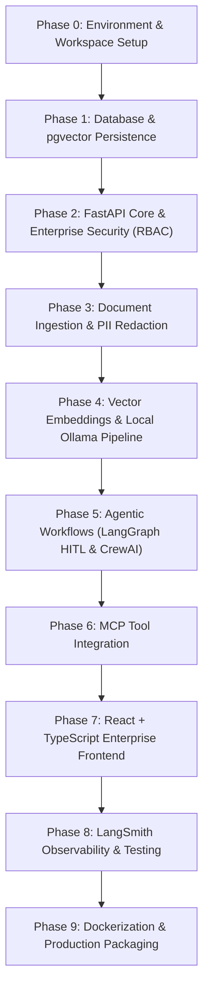

# DCI HireMind – Enterprise Development Roadmap

---

## Roadmap Overview

This roadmap breaks down the development of **DCI HireMind** into controlled, incremental phases. As an enterprise project, every phase establishes clean interfaces, tests, and documentation before moving forward.

---

## Phase Breakdown

### Phase 0: Environment & Project Foundation
**Goal**: Establish isolated development environments, version control, and standardized linting/formatting.
- **Tasks**:
  1. Initialize Git repository with enterprise `.gitignore`.
  2. Setup Python 3.12 virtual environment using modern dependency tooling (`uv` or `poetry` / standard `venv`).
  3. Setup Node.js (v20+ LTS) environment for the frontend.
  4. Configure code quality tooling:
     - Backend: `ruff` (fast linting and formatting), `mypy` (static type checking).
     - Frontend: `ESLint`, `Prettier`, `TypeScript` strict mode.
  5. Setup environment configuration template (`.env.example`) separating development and production secrets.
- **Deliverables**: Verified running clean backend and frontend boilerplate skeletons.

---

### Phase 1: Database Schema & Vector Persistence
**Goal**: Set up PostgreSQL 16 with the `pgvector` extension, define domain models, and implement migration management.
- **Tasks**:
  1. Set up local or Docker-based PostgreSQL 16 instance with `pgvector` enabled.
  2. Configure SQLAlchemy 2.0 (asynchronous engine with `asyncpg`).
  3. Design relational models:
     - `User`, `Role`, `Permission` (RBAC).
     - `JobRequisition` (status, requirements, criteria, salary range).
     - `Candidate` (contact details, status, source).
     - `Resume` (raw text, parsed JSON, anonymized text, vector embedding column).
     - `Evaluation` (match breakdown, gaps, suggested questions, AI rationale).
     - `HumanDecision` (recruiter ID, action, feedback, timestamp).
     - `AuditLog` (system-wide activity log).
  4. Initialize Alembic for version-controlled database migrations.
  5. Create database seeding scripts for default roles and dummy test jobs.
- **Deliverables**: Passing migration scripts, functional database connection test, verified vector extension.

---

### Phase 2: FastAPI Core & Enterprise Security (RBAC)
**Goal**: Implement the API gateway layer with authentication, role-based access control, and standard response envelopes.
- **Tasks**:
  1. Implement FastAPI application factory with structured middleware:
     - CORS configuration.
     - Global exception handling and structured error responses.
     - Request correlation ID for distributed tracing.
  2. Authentication & Authorization:
     - JWT-based authentication (access token + refresh token).
     - Password hashing with `bcrypt` / `argon2`.
     - Dependency-injected RBAC guards (`require_role(["ADMIN", "RECRUITER"])`).
  3. Base CRUD endpoints for Users and Job Requisitions.
  4. Interactive API documentation configuration (Swagger UI / ReDoc at `/docs`).
- **Deliverables**: Secure endpoints protected by JWT and role checks, verified with automated unit tests (`pytest`).

---

### Phase 3: Resume Ingestion & Ethical Blind Screening Pipeline
**Goal**: Build a secure file upload pipeline that parses resumes and sanitizes PII before storage and processing.
- **Tasks**:
  1. Secure file upload endpoint supporting PDF and DOCX formats with MIME-type and size validation.
  2. Document extraction service using `pypdf` and `python-docx` to extract structured sections (education, experience, skills, certifications).
  3. **PII Anonymization Service**:
     - Extract and isolate contact details (names, emails, phone numbers, addresses, social links).
     - Mask demographic signals (gender pronouns, age indicators, photos, non-relevant demographic data).
     - Create an `AnonymizedResume` representation for unbiased evaluation.
  4. Audit logging of all file uploads and anonymization events.
- **Deliverables**: Upload endpoint producing both raw (encrypted) and anonymized resume objects ready for vectorization.

---

### Phase 4: Local Vector Embeddings & Ollama Integration
**Goal**: Connect the platform to local LLMs via Ollama and store document embeddings in `pgvector`.
- **Tasks**:
  1. Install and verify local Ollama runtime with required models:
     - General LLM: `llama3.1:8b` or `mistral:7b` (or equivalent).
     - Embedding Model: `nomic-embed-text` or `bge-m3`.
  2. LangChain Ollama client wrapper with retry logic and fallback handling.
  3. Vectorization service:
     - Chunking strategies for resumes and job descriptions (semantic/recursive chunking).
     - Generate dense vector embeddings for job criteria and anonymized resume sections.
     - Store vectors in PostgreSQL using `pgvector` HNSW indexes for fast cosine similarity lookup.
  4. Semantic search endpoint: Find top matching candidates for a job requisition based purely on objective qualifications.
- **Deliverables**: Working semantic search endpoint matching anonymized resumes against job descriptions with similarity scores.

---

### Phase 5: Multi-Agent Intelligence (CrewAI & LangGraph HITL)
**Goal**: Build specialized agent squads for deep analysis and enforce strict Human-in-the-Loop approval workflows.
- **Tasks**:
  1. **CrewAI Multi-Agent Squads**:
     - *Job Analysis Agent*: Clarifies requirements and creates an objective evaluation rubric.
     - *Candidate Profiling Agent*: Extracts verified skills, years of experience, and project complexity from anonymized text.
     - *Gap Analysis Agent*: Identifies potential skill gaps or areas needing verification without making a rejection decision.
     - *Interview Guide Agent*: Generates tailored behavioral and technical questions mapped to the candidate's specific background.
  2. **LangGraph Stateful Workflow Engine**:
     - Define the recruitment workflow graph: `Ingest` $\rightarrow$ `BlindScreen` $\rightarrow$ `MatchAnalysis` $\rightarrow$ `HumanApprovalGate` $\rightarrow$ `ActionDispatch`.
     - Implement **LangGraph Checkpointing** (PostgreSQL-backed state).
     - Implement **`interrupt_before`** human approval breakpoint: workflow halts before any status transition until a recruiter reviews and submits an explicit decision.
- **Deliverables**: End-to-end agentic workflow that pauses at human gates and generates structured candidate dossiers with zero auto-rejections.

---

### Phase 6: Model Context Protocol (MCP) Integration
**Goal**: Integrate MCP to standardize how agents interact with internal tools and external enterprise systems.
- **Tasks**:
  1. Setup an MCP client within the FastAPI backend.
  2. Implement custom MCP servers or tools:
     - *ATS/HRIS Mock Connector*: Reads and writes candidate states to external systems.
     - *Calendar Connector*: Simulates interview availability checking.
     - *Skill Knowledge Graph*: Queries standard taxonomy (e.g., O*NET, ESCO) for skill equivalence (e.g., recognizing that "FastAPI" entails "Python REST APIs").
- **Deliverables**: Agents executing structured tool calls through the standardized MCP interface.

---

### Phase 7: React + TypeScript Enterprise Frontend
**Goal**: Build a responsive, accessible, and intuitive UI for recruiters and hiring managers.
- **Tasks**:
  1. Initialize React + TypeScript application with Vite and Tailwind CSS.
  2. Setup UI Component library (Radix UI / Shadcn UI patterns) and layout structure (Sidebar, Header, Breadcrumbs).
  3. Authentication flow: Login, token refresh, and RBAC-aware navigation.
  4. Core Views:
     - **Requisition Hub**: Create, edit, and view jobs with AI-assisted rubric tuning.
     - **Candidate Pipeline**: Visual Kanban / table with toggleable "Blind Mode" (anonymized view).
     - **Candidate Intelligence Dossier**: View AI match breakdown, gap analysis, and resume citations side-by-side.
     - **Human-in-the-Loop Approval Queue**: Dedicated screen to review pending recommendations, enter human notes, and advance/hold candidates.
     - **Audit Trail Dashboard**: Searchable activity log for compliance audits.
- **Deliverables**: Complete, polished web application interacting seamlessly with the FastAPI backend.

---

### Phase 8: LangSmith Observability & Enterprise Testing
**Goal**: Implement comprehensive testing, performance benchmarks, and LLM telemetry.
- **Tasks**:
  1. LangSmith Integration:
     - Configure project tracing for all LangGraph and CrewAI runs.
     - Monitor latency, token counts, error rates, and step execution.
     - Build evaluation datasets to benchmark screening consistency across model updates.
  2. Backend automated test suite:
     - Unit tests for PII redaction and scoring math.
     - Integration tests for API endpoints and database transactions.
     - Workflow tests verifying that human approval interruptions cannot be bypassed.
  3. Frontend testing with Vitest and React Testing Library.
- **Deliverables**: LangSmith dashboard with active traces and automated test suite with high coverage.

---

### Phase 9: Containerization & Deployment Packaging
**Goal**: Containerize the entire multi-service stack with Docker and Docker Compose for production-ready deployment.
- **Tasks**:
  1. Multi-stage `Dockerfile` for FastAPI backend (non-root user, slim Python base).
  2. Multi-stage `Dockerfile` for React frontend (Nginx alpine serving optimized static build).
  3. `docker-compose.yml` orchestrating:
     - `backend` (FastAPI)
     - `frontend` (React + Nginx)
     - `postgres` (with `pgvector` pre-installed)
     - `ollama` (optional containerized or bridged to host GPU)
  4. Health check scripts, volume management, and backup scripts.
  5. Deployment documentation and administrator handbook.
- **Deliverables**: Single-command startup (`docker compose up --build`) running the complete platform.

