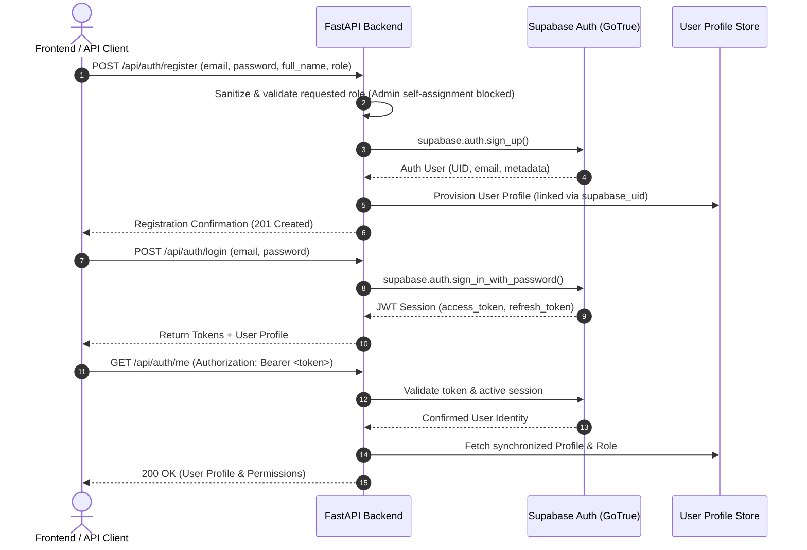

# DCI HireMind – Authentication & Role-Based Access Control (RBAC) Specification

---

## 1. Architecture Overview

DCI HireMind delegates user identity management, credential encryption, and session lifecycle to **Supabase Auth (GoTrue)**. The FastAPI application acts as an authorization enforcement layer that verifies Supabase-issued Bearer JWTs and synchronizes application profile records.



---

## 2. Defined Roles & Permissions Matrix

| Role | Scope & Permissions | Public Self-Registration Allowed? |
| :--- | :--- | :--- |
| **`Admin`** | System configuration, database governance, manual role elevation, audit logs access. | **No** (Direct self-assignment is strictly blocked with HTTP 400). |
| **`Recruiter`** | Job requisition creation, blind resume evaluation, interview question generation, HITL decisions. | Yes (Permitted during signup for talent acquisition staff). |
| **`Candidate`** | Profile management, resume upload, personal job application status tracking. | Yes (Default registration role). |

---

## 3. User Profile Data Model

Profiles are maintained in the `users` table and linked 1:1 with Supabase Auth:

| Field | Type | Description |
| :--- | :--- | :--- |
| `id` | `INTEGER PRIMARY KEY` | Internal relational identifier. |
| `supabase_uid` | `VARCHAR(64) UNIQUE` | Supabase Auth UUID (foreign key to `auth.users`). |
| `email` | `VARCHAR(255) UNIQUE` | User's verified email address. |
| `full_name` | `VARCHAR(255)` | Full legal name. |
| `phone_number` | `VARCHAR(50)` | Primary contact number. |
| `role` | `VARCHAR(50)` | Canonical role (`Admin`, `Recruiter`, `Candidate`). |
| `is_active` | `BOOLEAN` | Account status flag (default `True`). |
| `created_at` | `TIMESTAMP WITH TZ` | UTC creation timestamp. |
| `updated_at` | `TIMESTAMP WITH TZ` | UTC last updated timestamp. |

---

## 4. API Endpoints Reference

All endpoints are accessible with `/api/auth/...` or `/api/v1/auth/...`:

### 4.1 `POST /api/auth/register`
- **Access**: Public
- **Request Body**:
  ```json
  {
    "email": "jane.recruiter@company.com",
    "password": "StrongPassword123!",
    "full_name": "Jane Recruiter",
    "role": "Recruiter",
    "phone_number": "+1-555-0199"
  }
  ```
- **Response (201 Created)**:
  ```json
  {
    "success": true,
    "message": "Registration successful.",
    "user": {
      "id": 1,
      "supabase_uid": "9b1deb4d-3b7d-4bad-9bdd-2b0d7b3dcb6d",
      "email": "jane.recruiter@company.com",
      "full_name": "Jane Recruiter",
      "role": "Recruiter",
      "phone_number": "+1-555-0199",
      "email_confirmed": false,
      "created_at": "2026-11-17T07:10:00Z"
    }
  }
  ```

### 4.2 `POST /api/auth/login`
- **Access**: Public
- **Request Body**:
  ```json
  {
    "email": "jane.recruiter@company.com",
    "password": "StrongPassword123!"
  }
  ```
- **Response (200 OK)**:
  ```json
  {
    "success": true,
    "message": "Authentication successful.",
    "access_token": "eyJhbGciOiJIUzI1Ni...",
    "refresh_token": "u4Q8f9...",
    "token_type": "bearer",
    "expires_in": 3600,
    "user": {
      "id": 1,
      "supabase_uid": "9b1deb4d-...",
      "email": "jane.recruiter@company.com",
      "full_name": "Jane Recruiter",
      "role": "Recruiter"
    }
  }
  ```

### 4.3 `POST /api/auth/logout`
- **Access**: Authenticated (`Authorization: Bearer <token>`)
- **Response (200 OK)**:
  ```json
  {
    "success": true,
    "message": "User session has been successfully logged out."
  }
  ```

### 4.4 `GET /api/auth/me`
- **Access**: Authenticated (`Authorization: Bearer <token>`)
- **Response (200 OK)**: Returns the caller's verified profile and active role.

### 4.5 `POST /api/auth/forgot-password`
- **Access**: Public
- **Request Body**:
  ```json
  {
    "email": "user@example.com",
    "redirect_to": "https://hiremind.app/reset-password"
  }
  ```
- **Response (200 OK)**: Safe generic confirmation that does not leak account existence.

---

## 5. Security & RBAC Implementation Rules

1. **Role Guard Usage in FastAPI**:
   ```python
   from fastapi import Depends
   from app.core.auth import require_roles, SupabaseUser

   @router.post("/jobs/create")
   async def create_job(current_user: SupabaseUser = Depends(require_roles(["Admin", "Recruiter"]))):
       ...
   ```
2. **Zero Plain-Text Passwords**: Passwords pass directly to Supabase Auth over TLS. No passwords or hash secrets are stored locally.
3. **No Service Role Keys in Frontend**: The client application only consumes `SUPABASE_ANON_KEY`. Administrative keys (`service_role`) reside strictly on the backend if needed.

